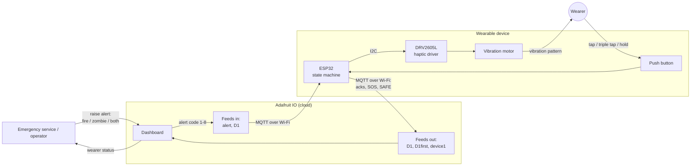
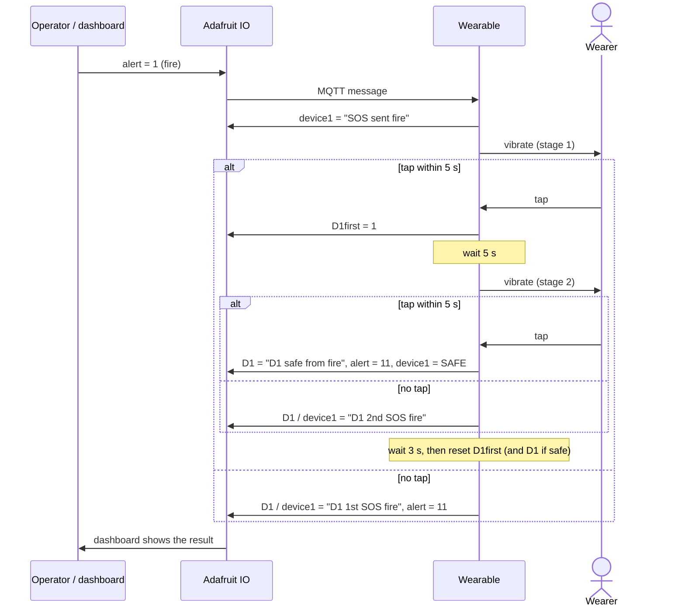
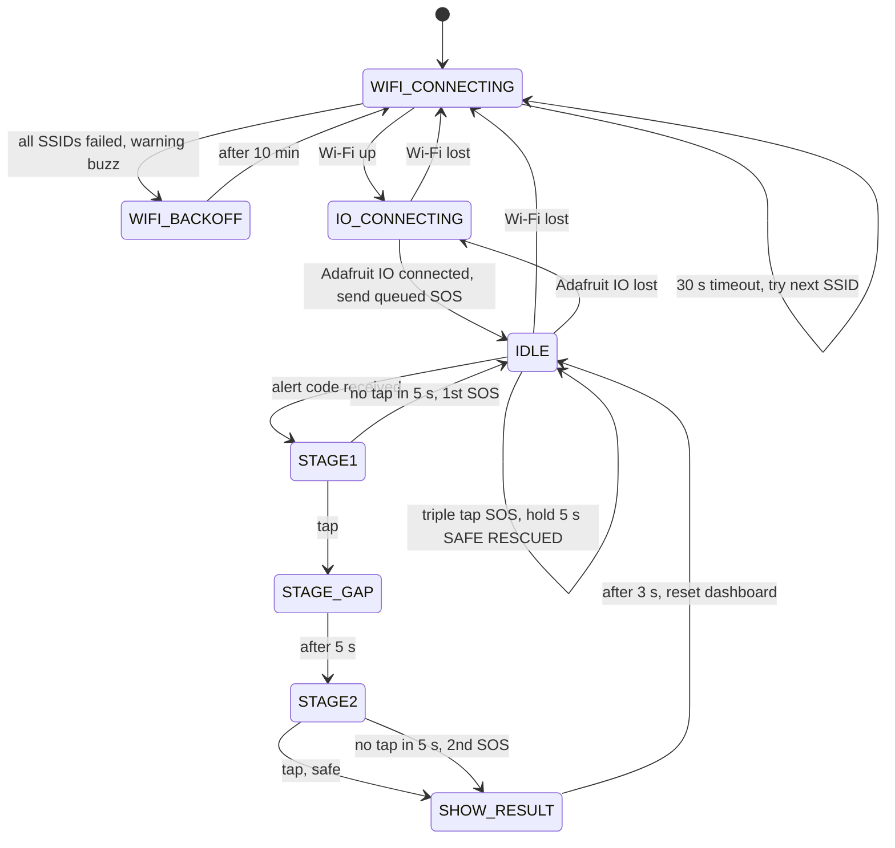

# Wearable-Based Alerting System for Humans

A wearable that warns its user about emergencies (fire, "zombie" — the test scenario
used in the thesis — or both) by **vibration**, and sends the wearer's response back to
emergency services through **Adafruit IO**. It is built for everyone, including people
who can't hear or see a normal alarm.

- Thesis report: [`ThesisReport-Group4newc.pdf`](ThesisReport-Group4newc.pdf)
- Slides: [`Thesis_ppt.pdf`](Thesis_ppt.pdf)

## Hardware

| Part | Notes |
|------|-------|
| ESP32 board with Wi-Fi | Code uses `Wire1` (the STEMMA QT port on Adafruit QT Py / Feather ESP32-S2/S3 boards) |
| Adafruit DRV2605L haptic driver + vibration motor | I²C on `Wire1` |
| Push button | Pin `A1` → GND (internal pull-up) |

## System overview



## How the wearer uses it

| Button action | When | Result |
|---------------|------|--------|
| **Tap** | Device is vibrating for an alert | Acknowledges that stage of the alert |
| **Triple tap** (taps < 1 s apart) | Any time not in an alert | Sends **SOS**. If offline, it is queued and sent as soon as the device reconnects |
| **Hold 5 s** | Idle | Sends **SAFE RESCUED** |

Every action that sends something gives one short confirmation buzz.

## Alert flow

The dashboard (or the emergency service) writes a code to the `alert` or `D1` feed:

| Code | Alert | Vibration pattern | Done code |
|------|-------|-------------------|-----------|
| `1` or `4` | Fire | Transition click (effect 58) every 200 ms | `11` |
| `2` or `6` | Zombie | Strong click (effect 1) every 100 ms | `22` |
| `3` or `8` | Both | Long ramp down (effect 70) every 150 ms | `33` |



Stage 1 asks "did you notice?" and stage 2 asks "are you safe?". A missed stage is
reported as an SOS. After an unanswered stage 2, `D1` keeps showing the SOS so it
doesn't vanish from the dashboard.

## State machine

The whole sketch is this one state machine (`wearable_alert.ino`):



If Wi-Fi or Adafruit IO drops while the device is idle, it goes back to the connecting states on its own.
An alert that is already running is never stopped: the vibration is local and keeps going.

## Adafruit IO feeds

| Feed | Direction | Contents |
|------|-----------|----------|
| `alert` | in / out | Alert codes in, done codes (`11`/`22`/`33`) out |
| `D1` | in / out | Alert codes in, per-alert status text out (`D1SOS`, `D1 1st SOS fire`, …) |
| `D1first` | out | Stage-1 acknowledgement (`1`/`2`/`3`), reset to `0` |
| `device1` | out | General status (`SAFE online`, `SOS`, `SAFE`, `SAFE RESCUED`, …) |

## Code layout

```
wearable_alert/
  wearable_alert.ino   one non-blocking state machine (no delay(), no nested loops)
  config.h             Wi-Fi networks and Adafruit IO credentials
test/
  test_alert.cpp       host simulation of the whole sketch
  fakes/               stand-ins for Arduino, Wi-Fi, Bounce2, DRV2605, Adafruit IO
```

`loop()` reads one button gesture, runs `io.run()` while online, then does one `switch (state)`.
Each state only checks its own timer and inputs, so the button, network and vibration are
always handled. All timings are constants at the top of the sketch.

## Build and flash

1. Install the ESP32 board package in the Arduino IDE, plus these libraries: **Adafruit DRV2605**,
   **Adafruit IO Arduino**, **Bounce2** (v2.6 or newer).
2. Put your Adafruit IO username/key and Wi-Fi networks in `wearable_alert/config.h`.
   Don't commit real credentials.
3. Open `wearable_alert/wearable_alert.ino`, choose your board and upload.
   The Serial monitor (115200 baud) prints every state change.

## Test without a board

```sh
c++ -std=c++17 -Itest/fakes test/test_alert.cpp -o /tmp/alert_test && /tmp/alert_test
```

This compiles the real sketch against fake hardware and simulates time. It checks every alert
path, triple tap, hold, offline SOS and Wi-Fi fallback by comparing the exact sequence of feed
writes.

## Keywords

AdafruitIO, alerting system, emergency situations, feeds, vibrations, state machine.
